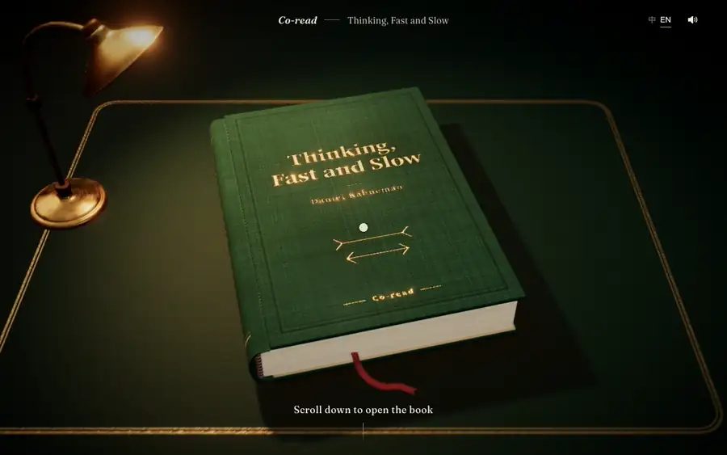
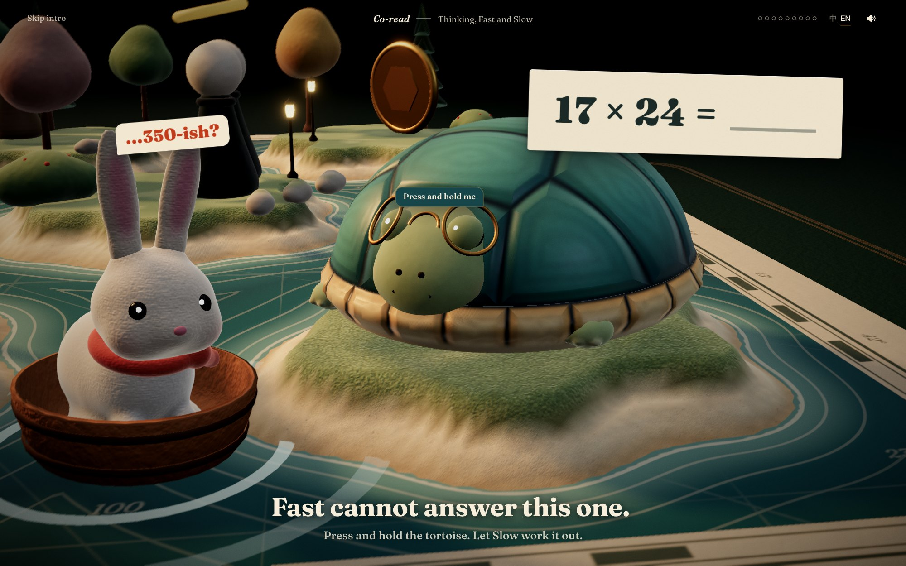
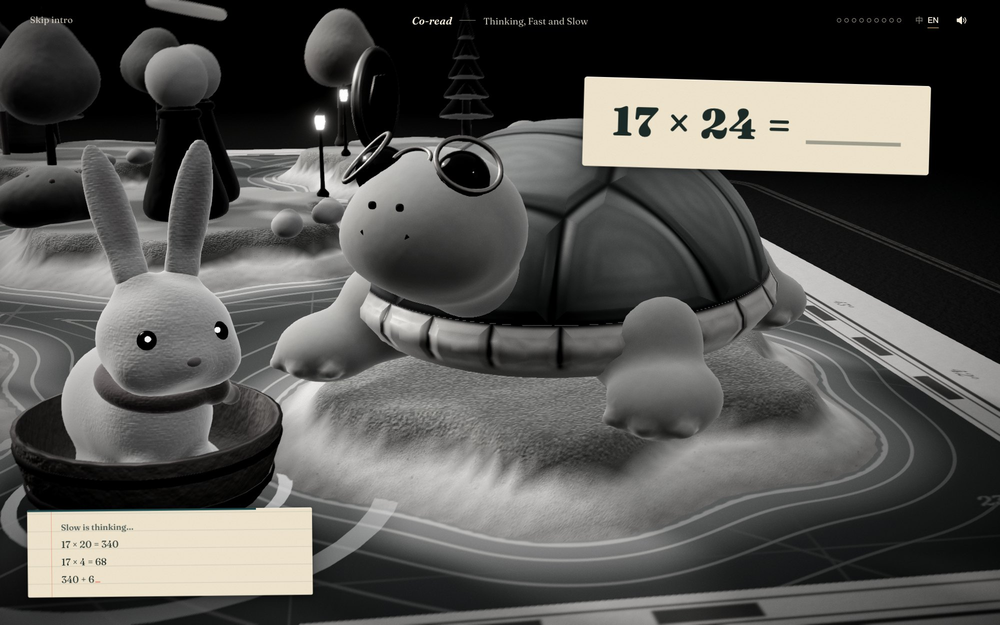
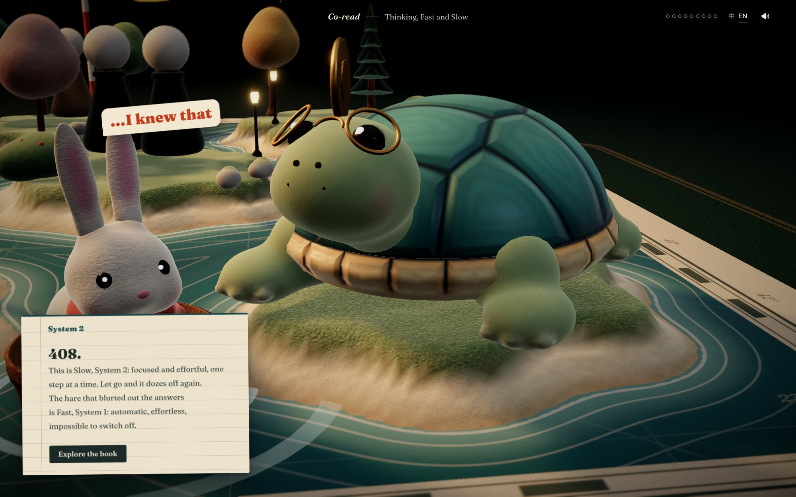
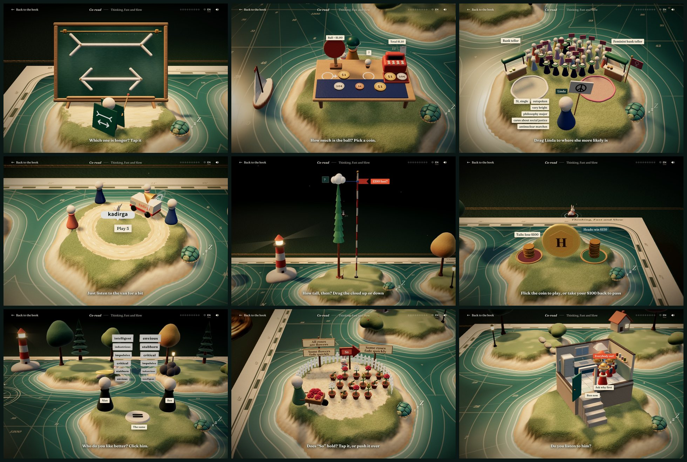
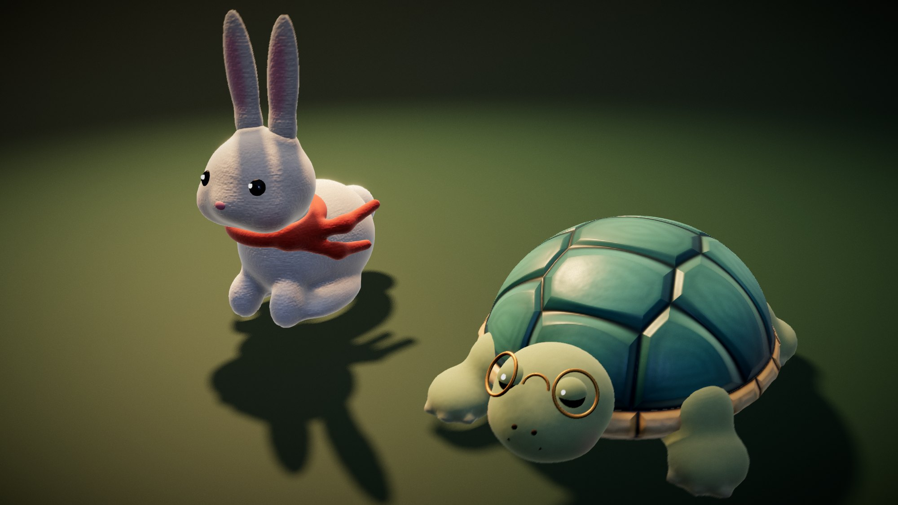
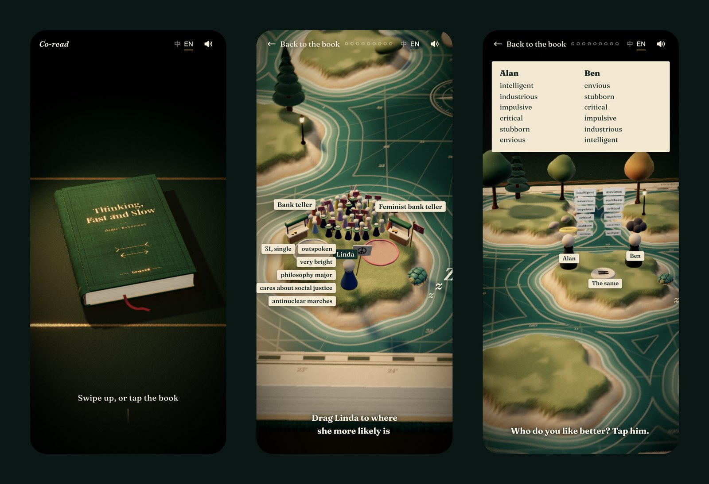

# Co-read · Thinking, Fast and Slow

An interactive companion to the first episode of **Co-read**, my video series about books. The first book is Daniel Kahneman's *Thinking, Fast and Slow*.

**Live site: [coread.yixiangli.com](https://coread.yixiangli.com/thinking-fast-slow/)** · English and Chinese · desktop and phone



## What it is

A closed book lies on a leather desk under a brass lamp. Scroll, and it opens. The spread turns into a nautical chart with nine small islands on it, one for each of the book's best-known experiments.

Kahneman describes the mind as two characters. Here they are a hare and a tortoise.

- **The hare is Fast**, System 1. It is your cursor. It follows you around the chart and blurts out an answer before you have finished reading the question.
- **The tortoise is Slow**, System 2. It sleeps on its own island. Press and hold it and it wakes up and works the problem through, one step at a time, in a notebook. While it thinks, the world around it slows down and loses its colour. Let go and it dozes off again.

<table>
  <tr>
    <td></td>
    <td></td>
  </tr>
  <tr>
    <td align="center"><sub>Fast answers first: “…350-ish?”</sub></td>
    <td align="center"><sub>Hold the tortoise and the world slows down while Slow does the sum</sub></td>
  </tr>
</table>

Each island opens into its own small world where the experiment is acted out rather than written down. You answer the way you naturally would, which is usually Fast's way. Then you hold the tortoise and watch the reasoning unfold. Every case ends with a short note on what the research found.



## The nine islands



| Island | What you do | What it shows |
| --- | --- | --- |
| The man with two lines | Tap the longer line | The Müller-Lyer illusion. You learn the lines are equal and they still look different |
| The van on repeat | Listen to a van play a made-up word over and over | The mere exposure effect |
| Measuring the redwood | Hear a number first, then drag a cloud to guess the tree's height | Anchoring. Half of the visitors hear 1,200 feet and half hear 180 |
| “Everybody out!” | A fire captain shouts for no reason he can name. Run, or ask why? | Expert intuition, and when it can be trusted |
| A bat and a ball | Pick the coin you think the ball costs | The bat-and-ball question, where Fast jumps in with 10 cents |
| Alan and Ben | Pick the person you like better | The halo effect. They are described by the same six words in reverse order |
| The rose gardener | Decide whether the “So” sign holds up, and push it over if it doesn't | Belief bias. The conclusion is plausible, the logic is not |
| The rolling coin | Lose $100 on tails, win $150 on heads. Play or pass? | Loss aversion |
| Linda | Drag Linda into the group she more likely belongs to | The conjunction fallacy |

The islands can be visited in any order. After all nine, the book counts how many of the questions with a right answer Fast got right.

## Built entirely in code

The site downloads no 3D models, no texture images and no HDR environment maps. Every shape and every surface is generated in the browser when the page loads.



- **Sculpting with distance fields.** Soft things (the hare, the tortoise, tree crowns, rocks, boats) are built from ellipsoids, capsules and tori blended with a smooth union, then meshed with naive surface nets. Normals come from the field's gradient, and ambient occlusion is read from the same field and baked into vertex colours. See [`sdf.ts`](thinking-fast-slow/site/src/world/sdf.ts) and [`chars.ts`](thinking-fast-slow/site/src/world/chars.ts).
- **Islands** are height fields grown from a smooth-union outline: a sandy rim at the waterline, a rounded step, then grass on top ([`isles.ts`](thinking-fast-slow/site/src/world/isles.ts)).
- **Materials are shaders.** One clay material, extended through `onBeforeCompile`, adds object-space grain, wrap lighting and a soft rim, and decides per pixel from the base colour whether a surface should read as wood, aged brass, enamel, lacquer or felt. The tortoise's shell plates are drawn in the fragment shader from a handful of Voronoi seeds ([`kit.tsx`](thinking-fast-slow/site/src/world/kit.tsx)).
- **The sea is a chart.** Water depth comes from a distance-to-shore field computed analytically from the island outlines. The shader draws four depth contours with a slow pulse travelling along them, a coastline, a graticule and soft waves. A compass rose, rhumb lines and depth soundings are painted onto a canvas in code ([`Sea.tsx`](thinking-fast-slow/site/src/world/Sea.tsx), [`tex.ts`](thinking-fast-slow/site/src/world/tex.ts)).
- **The book** is a cloth hardback with a foil-stamped title. Its cover, pages and endpapers are painted on canvases, and the pages bend as they turn ([`Book.tsx`](thinking-fast-slow/site/src/world/Book.tsx), [`bookTex.ts`](thinking-fast-slow/site/src/world/bookTex.ts)).
- **Light** comes from one warm lamp with soft shadows and a faint cool fill. Reflections come from a few light panels assembled in code instead of an HDR file ([`Env.tsx`](thinking-fast-slow/site/src/world/Env.tsx)). Post-processing is bloom, tilt-shift, ACES tone mapping, SMAA, a vignette and light film grain.

## Performance

- The first visit downloads about 1 MB: roughly 600 KB of JavaScript (three.js is most of it) and 400 KB of fonts.
- The Chinese serif font is cut down at build time to the 550 or so characters the site actually uses. That brought the fonts a Chinese-speaking visitor downloads from about 1.35 MB to about 400 KB. A check after every build fails if any character on the page is missing from the subset ([`fonts.mjs`](thinking-fast-slow/site/tools/fonts.mjs)).
- On an Apple M2 laptop at 2160 × 1350, with the frame cap removed, the chart runs at about 100 fps and the island worlds at about 105 to 110.
- The loading screen is plain HTML in `index.html`, so it appears as soon as the page does. It stays up while the geometry is generated and the first frames are drawn, and lifts once the book is on the desk.
- Each island world is its own chunk, fetched in the background after the book opens. When you enter one, the camera waits until the scene has been built before it dives in, so the move itself doesn't stutter.
- Image quality steps down through four levels if the frame rate stays low. Phones and laptops in low-power mode often cap the browser at 30 fps, and a steady cap like that is not counted as a slow device, so the picture stays sharp.

## On phones



The layout adapts to portrait and landscape phones and to tablets. Labels that follow points in the 3D scene move back inside the screen when they would be cut off at an edge. On portrait phones, where the words written on the islands are too small to read, the islands that depend on reading (Alan and Ben, the rose gardener) also show their text on a paper card above the scene.

## Details

- **Language.** The site picks Chinese if any of the browser's languages is Chinese, or if the system time zone is in mainland China, Hong Kong, Macau or Taiwan. Otherwise it starts in English. There is no IP lookup. A language chosen by hand is remembered.
- **Line breaks.** Both languages get typographic care before text reaches the page. English keeps short words like *a* and *of* off the ends of lines and joins the last two words of a sentence when they are short, so a paragraph rarely ends on a lone word. Chinese uses the browser's word segmenter so that words are not split across lines. See [`typo.ts`](thinking-fast-slow/site/src/typo.ts).
- **Fallbacks.** If a device cannot draw WebGL, the site says so and suggests a browser. If the browser drops the 3D context (this sometimes happens when a phone switches apps), it offers a reload.

## Running it locally

Requires Node.js 22 or later.

```bash
cd thinking-fast-slow/site
npm install
npm run dev
```

`npm run build` writes the production site to `dist/`, and `npm run preview` serves it.

Some URL parameters make it quicker to work on one part:

| Parameter | Effect |
| --- | --- |
| `?lang=en` / `?lang=zh` | Force a language |
| `?table` | Skip the book and the introduction, start on the open chart |
| `?micro=folder` | Go straight into one island (`lines`, `vinyl`, `tree`, `helmet`, `paddle`, `pawn`, `rose`, `coin`, `folder`) |
| `?panel=folder` | Show an island's finished notebook card (`?panel=intro` for the introduction) |
| `?model=hare,tortoise,lamp` | Look at the characters on their own |
| `?lv=2` | Start at a lower quality level (0 to 3) |
| `?no=bloom,tilt,aa,grain` | Turn individual post-processing passes off |

### Checks

The scripts in [`tools/check`](thinking-fast-slow/site/tools/check) drive a real Chrome through puppeteer against a built copy of the site (by default on port 5190; set `BASE` to point them at any URL, and `CHROME` if Chrome is not in the default macOS location).

- `final.mjs` plays the whole thing in one or both languages: opens the book, holds the tortoise, enters and leaves all nine islands, finishes Linda and opens the end card. It reports page errors, failed requests and the longest frames, and saves screenshots. `VIEW=390x844 TOUCH=1` runs it as a phone.
- `views.mjs` photographs key screens at eight screen sizes and flags text that overflows the screen, type below 11 px and tap targets smaller than 32 px.
- `slow.mjs` loads the site over a throttled network with a throttled CPU and records what is on screen every half second.
- `weight.mjs` adds up what a first visit downloads.

[`tools/readme-shots.mjs`](thinking-fast-slow/site/tools/readme-shots.mjs) regenerates the images in this README.

## Deploying

The site is served as static files from Cloudflare. [`deploy/`](deploy) collects each book's build into its own folder (this one is `/thinking-fast-slow/`), sends the root address to the latest book, adds a 404 page and sets long cache lifetimes for the fingerprinted assets.

```bash
cd thinking-fast-slow/site && npm run build
cd ../../deploy && npm install && npm run deploy
```

Deploying uses Cloudflare's `cf` command-line tool and needs `cf auth login` once.

## Layout

```
deploy/                     Cloudflare config and the script that assembles each book's build
docs/                       Images for this README
thinking-fast-slow/site/
  index.html                Page shell and the HTML loading screen
  src/
    App.tsx                 Stages (book, introduction, chart, island, end), interface, notebook
    World.tsx               The three.js canvas, quality levels, island loading
    scenes.ts               The nine cases in both languages
    micro/                  One file per island world
    world/                  Book, desk, sea, islands, characters, lights, materials, camera
    typo.ts, i18n.ts        Line breaking and language
  tools/                    Font subsetting, screenshots, recording, checks
```

## Credits

The experiments come from *Thinking, Fast and Slow* by Daniel Kahneman (2011) and the research it draws on, including work by Amos Tversky, Shane Frederick, Robert Zajonc, Solomon Asch and Gary Klein. The wording on the site is my own retelling, not quoted from the book.

Built with [three.js](https://threejs.org), [React Three Fiber](https://r3f.docs.pmnd.rs) and [drei](https://github.com/pmndrs/drei), [postprocessing](https://github.com/pmndrs/postprocessing), [GSAP](https://gsap.com) and [Vite](https://vite.dev). Type is set in [Noto Serif SC](https://fonts.google.com/noto/specimen/Noto+Serif+SC) and [Fraunces](https://fonts.google.com/specimen/Fraunces), both under the SIL Open Font License.

No license has been chosen for this repository yet, so all rights are reserved for now.
